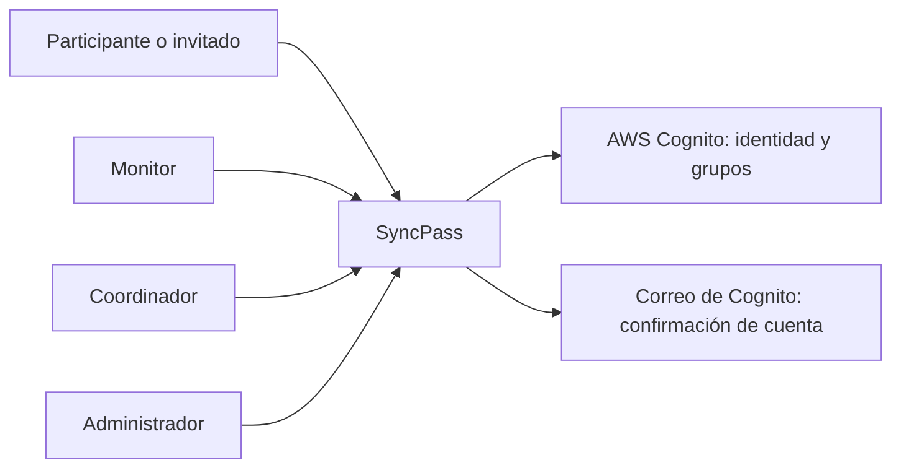
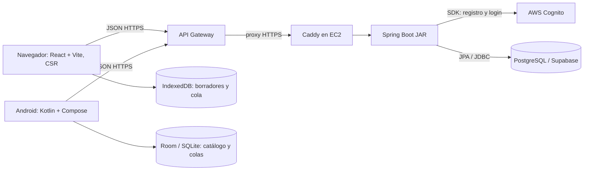
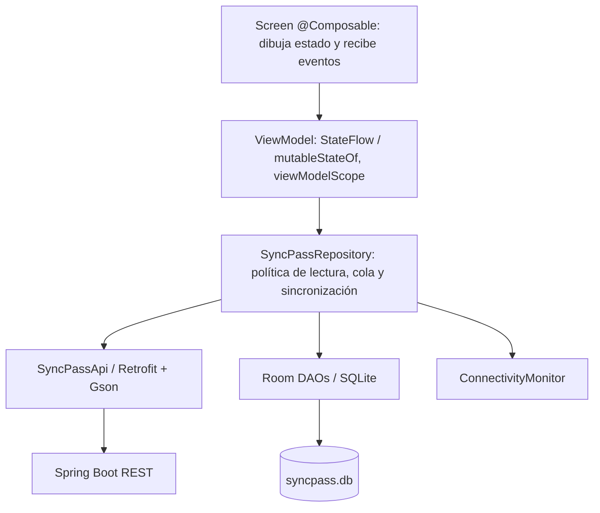

# Arquitectura de SyncPass — evaluación móvil 3

Esta descripción corresponde al código de `web-react/`, `mobile-kotlin/` y `backend/`. Hay dos modos de ejecución: **local**, con Docker Compose y PostgreSQL del equipo; y **nube**, con Vercel, API Gateway, EC2 y Supabase. Cognito es el servicio de identidad en ambos modos cuando hay Internet.

## C1 — Contexto



El participante consulta talleres, entra por código o QR y registra asistencia; el monitor acredita QR y encuestas; coordinador y administrador administran proyectos, talleres y bitácoras. El invitado no obtiene un grupo de Cognito: se identifica con un UUID del dispositivo y un nombre declarado. No se debe confundir ese registro con identidad verificada.

## C2 — Contenedores y datos



**Orden real del login:** cliente → API Gateway → Caddy → Spring Boot → Cognito. La API devuelve tokens; en llamadas protegidas, Spring Security comprueba firma, emisor, vencimiento, `token_use=access`, `client_id` y grupo. Gateway publica la ruta HTTPS; el control de roles está en Spring. La web no llama directamente a Cognito.

En local, navegador → `http://localhost:18080` → JAR Docker → PostgreSQL Docker. Gateway, Caddy y Supabase se sustituyen solo para ejecutar en el equipo; el código de API es el mismo. Android local usa `adb reverse` y una compilación debug con URL local. Cognito todavía requiere Internet.

## C3 — Componentes Android



`MainActivity` aloja `NavHost`; no es un ViewController de UIKit. `ui/screens/*Screen.kt` contiene vistas Compose, `*ViewModel.kt` sus estados y acciones, `data/SyncPassRepository.kt` centraliza las dos fuentes, y Room define `TallerDao`, `PendingDao` e `IngresoDao`. La cámara (CameraX/ML Kit) y la ubicación (`LocationManager`) son dos APIs nativas usadas por la app. Los permisos se piden desde la pantalla porque dependen del ciclo de vida de Android; el resultado se entrega al ViewModel.

**Sin conexión:** el repositorio lee el catálogo de Room y guarda asistencias o encuestas pendientes. Al recuperar red, `ConnectivityMonitor` emite el cambio y el ViewModel solicita el envío. La API devuelve aceptación o rechazo; las filas aceptadas se eliminan de la cola. El ingreso es idempotente por taller y participante para evitar duplicados en reintentos. El login nuevo requiere Internet; la sesión Android actual permanece en memoria y se pierde si el proceso se cierra.

## C3 — Componentes del backend

```mermaid
flowchart LR
  http[Petición HTTP / JSON] --> controller[@RestController: ruta, validación, respuesta]
  controller --> service[@Service: reglas y transacciones]
  service --> repository[Spring Data Repository / JdbcTemplate]
  repository --> postgres[(PostgreSQL)]
  service --> cognito[Cognito SDK cuando es autenticación]
```

Los paquetes `auth`, `taller`, `proyecto`, `ingreso`, `sync`, `bitacora` y `grabacion` separan los dominios. `Taller` y `Proyecto` son entidades JPA; `TallerRepository` y `ProyectoRepository` hacen persistencia; `TallerService` aplica filtros, cupos y versión optimista. `IngresoService` bloquea la fila del taller con `FOR UPDATE` antes de asignar el último cupo. Flyway aplica `V1`–`V6` al iniciar.

## Web: CSR y mantenedores

`main.tsx` monta React en `index.html`; Wouter en `App.jsx` cambia de página sin pedir HTML nuevo al servidor. `clients/api.ts` usa `fetch` para JSON. `SessionProvider` conserva la sesión web y las rutas comprueban roles; el backend vuelve a comprobarlos. Los mantenedores de proyectos (`/proyectos`) y talleres (`/talleres`) usan API REST. Los borradores de `/borradores` usan IndexedDB local. Vite compila archivos estáticos que Vercel o Nginx pueden servir.

## Límites comprobables

- El audio grabado en web se descarga localmente; **no se sube ni se transcribe automáticamente**. El resumen extractivo y las respuestas usan la transcripción o apuntes publicados en la bitácora.
- El estado de grabación informa si se grabó el taller y si ya existe resumen. Es un aviso en la vista, no correo automático.
- La cola móvil sincroniza con la app abierta. No hay `WorkManager` para hacerlo tras cerrar el proceso.
- Los SVG de `mockups.html` son maquetas navegables; los enlaces a la aplicación abren funciones reales y aplican el rol de la sesión.
