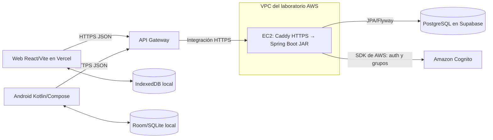

# Arquitectura implementada de SyncPass

## Componentes

Este es el recorrido de la pizarra aplicado a SyncPass. La web y Android llegan a **la misma API**, no se conectan directamente entre sí ni a PostgreSQL. El backend usa Cognito para registro/login y grupos. Spring Security comprueba el JWT y los roles al atender rutas protegidas; API Gateway da la entrada HTTPS y enruta hacia EC2. No se debe describir el simple paso por Gateway como una validación de roles.

La web usa React, Vite, entrada y módulos TypeScript, páginas JSX, rutas Wouter, CSS propio y utilidades Tailwind. El móvil es Kotlin con Jetpack Compose. JPA persiste datos de negocio y Flyway aplica migraciones en PostgreSQL/Supabase. IndexedDB y Room/SQLite son fuentes **locales por dispositivo**: guardan copia del catálogo o una cola pendiente, no sustituyen a la base compartida.

## Capas de la pizarra

| Pizarra | SyncPass web | SyncPass Android |
| --- | --- | --- |
| Vista | Página/componente React | Pantalla Compose |
| ViewModel/estado | Estado y hooks/contexto React | `HomeViewModel` + `HomeUiState`; otras pantallas aún requieren el mismo patrón |
| Repositorio | `clients/api.ts` para HTTP y `data/localDb.js` para IndexedDB; todavía no hay un repositorio único | `SyncPassRepository` coordina Retrofit y Room |
| Fuente remota | API Gateway → EC2 → PostgreSQL/Cognito | La misma API Gateway |
| Fuente local | IndexedDB del navegador | Room/SQLite del teléfono |

Un DTO define el contrato JSON que cruza la red. Las entidades JPA y Room representan estructuras de persistencia; sus campos pueden diferir del DTO. El contexto React del repositorio de ejemplo del docente distribuye estado entre componentes, pero no es un servidor ni una conexión de red.

## Flujos para demostrar

1. Usuario inicia sesión en web o Android; la API valida las credenciales con Cognito y entrega la sesión.
2. El frontend adjunta el token al consumir los endpoints protegidos.
3. Administrador o coordinador ejecuta CRUD de talleres y proyectos comunitarios mediante la API.
4. El móvil guarda borradores locales y los sincroniza cuando hay conectividad, según las funciones implementadas.

Para demostrar comunicación real: crear un taller en la web, pulsar **Actualizar talleres** en Android y comprobar el mismo ID; guardar una asistencia móvil sin señal, sincronizarla y verificar el quórum en web. Si una operación sigue solo en Room o IndexedDB, el otro cliente no puede verla aún. La matriz de pruebas y sus estados están en `docs/PLAN_VERIFICACION_COMUNICACION.md`.

## Despliegue y límites

Vercel sirve el frontend. API Gateway publica HTTPS hacia Caddy en EC2, que reenvía a Spring Boot en `127.0.0.1:8080`. EC2 está dentro de la VPC del laboratorio; el puerto interno 8080 no se publica. La IP pública puede cambiar al reiniciar el laboratorio; `syncpass-gateway-sync` actualiza el nombre `nip.io`, el certificado y la integración de Gateway. Supabase y Cognito son servicios externos a esa EC2. La API depende de que el laboratorio permanezca activo: un 503 en Gateway no queda resuelto por la disponibilidad de Vercel. El procedimiento está en `docs/OPERACION_LAB.md`.

El flujo QR/GPS ya tiene implementación y pruebas locales; su recorrido completo en teléfonos y su despliegue nuevo en EC2 aún requieren comprobación.

La entrada `main.tsx`, la sesión, el cliente HTTP, el aviso de geocerca y el parser QR usan TypeScript; las páginas siguen en JSX. Tailwind está configurado con preflight desactivado para preservar la paleta propia.
